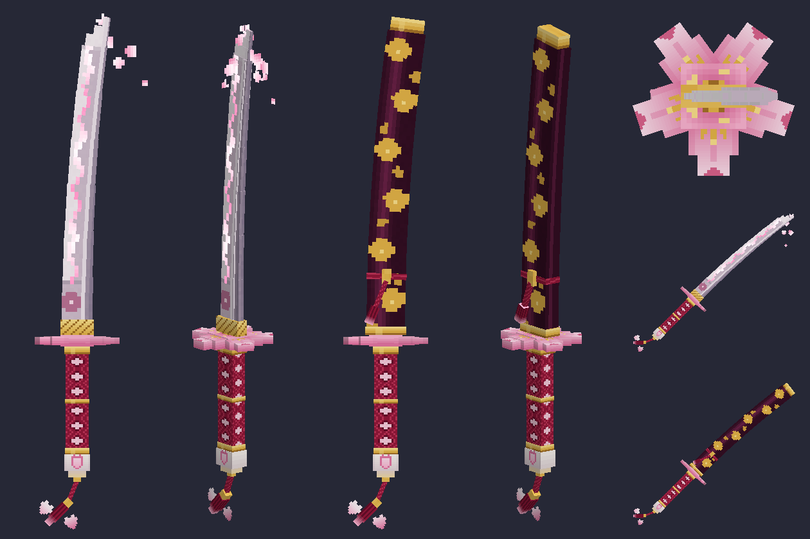
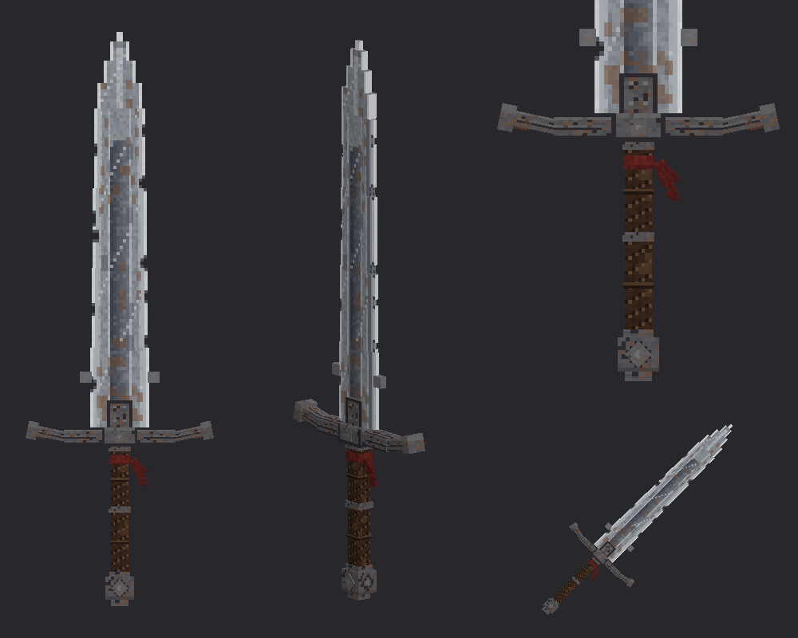

# Sakura Katana and Warrior Greatsword

Two 3D item models for Minecraft Java Edition 1.21.11, each with a Blockbench project, shipped in one resource pack.





## Contents

| Path | What it is |
| --- | --- |
| `blockbench/sakura_katana.bbmodel` | Blockbench project (Java Block/Item), drawn katana, 55 cubes |
| `blockbench/sakura_katana_sheathed.bbmodel` | Blockbench project, katana in its saya, 38 cubes |
| `blockbench/warrior_greatsword.bbmodel` | Blockbench project, greatsword, 46 cubes |
| `resourcepack/` | Ready-to-use resource pack (pack format 75) |
| `tools/build_katana.py`, `tools/build_greatsword.py` | Generators for everything above (Python 3, standard library only) |
| `tools/check_outputs.py` | Sanity checks for the generated models and projects |

## Using it in game

Copy `resourcepack/` into `.minecraft/resourcepacks/` (or zip its contents), enable it, then:

```
/give @s minecraft:netherite_sword[minecraft:item_model="sakura:sakura_katana"]
/give @s minecraft:netherite_sword[minecraft:item_model="sakura:sakura_katana",minecraft:custom_model_data={strings:["sheathed"]}]
/give @s minecraft:netherite_sword[minecraft:item_model="warrior:warrior_greatsword"]
```

## Sakura Katana

Textures live in `resourcepack/assets/sakura/textures/item/`:

- `sakura_katana.png` – 128×128 base sheet
- `sakura_katana_e.png` – 128×128 emissive layer (hamon glow), 8 animated frames, same layout as the base sheet
- `sakura_petals.png` – 64×64 emissive drifting petals, 16 animated frames

Cube groups: `blade`, `tsuba`, `handle`, `pommel`, `tassel`, `petals` (and `saya` in the sheathed project).

Vanilla item models cannot spawn particles or move cubes, so:

- **Hamon glow** – thin overlay cubes use the emissive texture with `light_emission: 15`, so the line stays lit in the dark and shimmers through an animated texture.
- **Petals** – two crossed emissive planes at the blade tip play an animated texture of drifting petals.
- **Blade and tassel sway** – stored as an `idle` animation in the Blockbench projects, keyed to the `blade` and `tassel` groups. The Java item format does not play it; convert the project (File → Convert Project) or use a plugin such as Animated Java to use it.

## Warrior Greatsword

A 45-pixel-long two-handed sword that fills almost the whole model volume: a broad double-edged blade with a recessed fuller, parrying lugs, a canted iron crossguard, a leather-wrapped grip and an iron pommel.

- Texture: `resourcepack/assets/warrior/textures/item/warrior_greatsword.png` (128×128), weathered steel with rust, scratches and stains.
- Cube groups: `blade`, `guard`, `handle`, `pommel`, `cloth`.
- The chips in the cutting edges are transparent texels on the thin edge cubes, so they show in the silhouette without extra geometry.
- The tattered cloth tied under the guard has an `idle` sway animation in the Blockbench project (same limitation as above).

## Rotations

The katana's blade curve and tsuba petals and the greatsword's canted quillons use free-angle element rotations, which need 1.21.11 and a current Blockbench. For older targets pass `--legacy-rotation` to either generator to rebuild with 22.5° steps.

## Rebuilding

```
python3 tools/build_katana.py
python3 tools/build_greatsword.py
python3 tools/check_outputs.py
```
